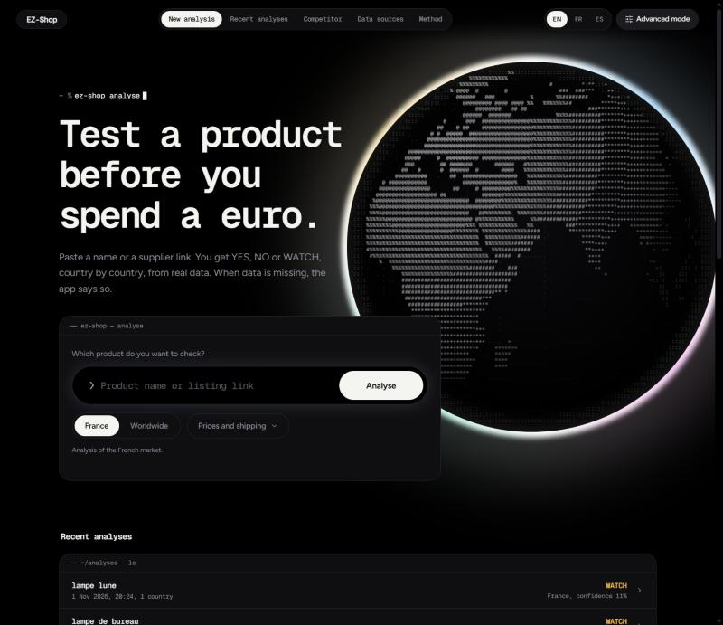
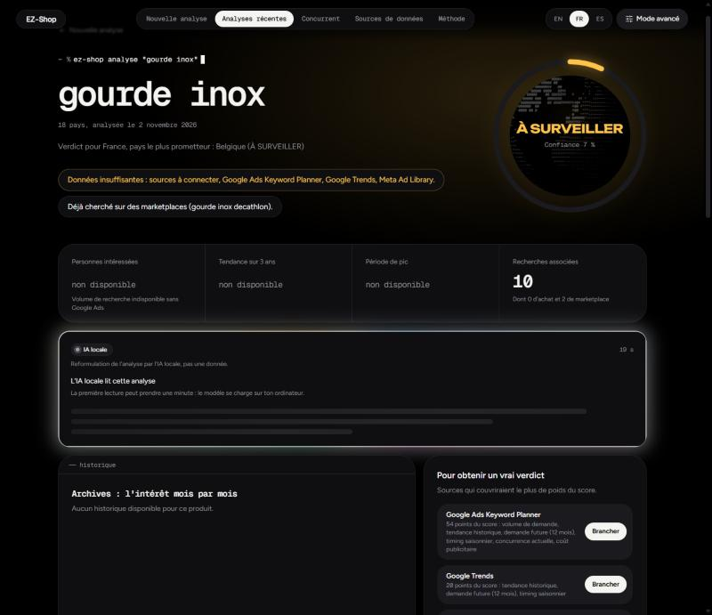

# EZ-Shop

**Pre-launch product research for e-commerce and dropshipping, country by country, with real data only and a local AI.**

Give EZ-Shop a product name or a supplier link (Temu, AliExpress, Alibaba, 1688). For each target country it tells you
**YES, NO or WATCH**, with the reason, the blocking factors and a confidence score, before you spend anything on stock
or ads. The interface is available in **English, French and Spanish**.



## Quick start

Requirements: **Node.js 22.12+** and npm. Windows, macOS or Linux.

```bash
git clone https://github.com/Milis0f/EZ-Shop.git
cd EZ-Shop
npm install
cp .env.example .env.local
npm run dev
```

Open http://localhost:3000. No database server, no Docker and no API key are needed for a first analysis: a local
PGlite database is created in `.data/pglite`, and the open sources (World Bank, Eurostat, OECD, Wikipedia, Google
Autocomplete, customs tariffs, VAT, ECB exchange rates) answer without an account.

### Optional: enable the local AI

Click **Install the AI** in the app: it downloads the free model (about 5.7 GB), checks the file and can resume if
stopped. Or download it yourself into `.data/models/`:

```bash
pip install -U huggingface_hub
hf download unsloth/Qwen3.5-9B-GGUF Qwen3.5-9B-Q4_K_M.gguf --local-dir .data/models
```

SHA-256: `03b74727a860a56338e042c4420bb3f04b2fec5734175f4cb9fa853daf52b7e8`. A GPU with about 8 GB of VRAM is
recommended (Vulkan, CUDA or Metal through prebuilt binaries; CPU works, slowly). Set `LOCAL_AI_MODEL_PATH` to use
another location, or `LOCAL_AI_ENABLED=false` to turn the AI off. Without the model, everything else works.

**Settings → Local AI** shows this computer's memory and graphics card (and the share the loaded model takes), and
offers four Qwen models, each marked fast, split, slow or too heavy for this machine, with one suggested:
Qwen 3.5 2B (1.3 GB) and 4B (2.7 GB) for small computers, 9B (5.7 GB, the default), and Qwen 3.8 27B (16.5 GB) for
large cards. Each
download is checked against its SHA-256 before use; switching frees the loaded model. `LOCAL_AI_GPU=off` keeps the
model on the processor.

### Optional: enable web search

Free too: [SearXNG](https://github.com/searxng/searxng), an open-source search engine, runs on your own computer with
no key and no account. On Windows it installs inside WSL; on macOS and Linux, directly. Once installed, the app starts
it by itself.

```bash
npm run search:setup
```

### Other commands

```bash
npm run build && npm start   # production
npm test                     # unit tests
npm run typecheck && npm run lint
```

## What it does

- **A verdict per country**: YES, NO or WATCH, with one line of reason and the blocking factors (e.g. a loss at
  your selling price). Missing data gives « WATCH, insufficient data », never an optimistic guess.
- **Real data only**: every value carries its source and its kind (observed, assumption, derived, estimate). When a
  value is missing or unreliable, the app shows `DATA_INSUFFICIENT` with the reason. No number is ever invented.
- **Your own numbers**: supplier price, shipping, planned selling price and target margin give your landed cost
  (duties included), your margin at your price and the minimum price for your target margin.
- **Supplier links recognised offline**: the app reads the platform and product id from the URL and never scrapes
  supplier pages.
- **Simple and expert modes**: the simple mode leads with the verdict; the expert mode shows the score out of 100,
  its criteria, confidence, sources, limits and a per-provider source journal.
- **Country level only**, 18 countries supported.
- **Three languages**: English (default), French and Spanish, chosen from the switcher in the navigation bar.
  Numbers, prices and dates follow the chosen language.
- **The planet is the menu**: the home page is the ASCII planet alone, with Analyse, My shop, Settings, Data
  sources and Competitor around it; pointed at, each opens its choices. Other pages fold them into a ring of light at
  the top left. Without the local AI the planet loses its halo and offers to install it.
- **Terminal-inspired OLED design**: true black, dark only, monospaced titles and figures, an ASCII planet with the real country outlines and
  a white aura around the AI, with motion that respects reduced motion settings.

## The local AI

EZ-Shop runs an AI model **entirely on your own computer**: Qwen3.5-9B (open model, Apache-2.0), loaded on your GPU
through [node-llama-cpp](https://github.com/withcatai/node-llama-cpp), inside the app. No cloud, no API key, no data
leaves your machine.

On each analysis it writes, in the interface language, a short summary, one line per country, up to three concrete next steps, and a
hypothesis about what the product is. It only rewords the stored analysis: **every number it cites is checked
against the analysis data**, and a reading that cites a number not found there is discarded and never shown. It never
produces data. Everything the AI wrote is marked by a small animated « aura », so you always know what comes from the
AI and what comes from the data.



## Web search and competitors

- **Web search, only if you say yes**: under each report the app asks before searching. It looks from several angles
  (the words, their price, their reviews), reads up to six pages, and shows the prices they declare. The AI answers in
  one sentence with figures, a table or a bar chart. Only the search words leave your computer, and the result never
  enters a score or a verdict. Every figure must appear on the page it cites, or it is removed.
- **Competitor check**: paste a product page. The report shows what the page publishes (prices, variants, stock on
  Shopify, publication date, reviews, delivery, apps) and keeps clues apart from facts, in six parts:
  - **Shop**: on Shopify, its card (`/meta.json`: city, currency, countries served, products published), up to 1,000
    products of its catalogue (prices, brands, types, tags, discounts, sold-out products, launches month by month),
    its collections and its best sellers (the best-selling sort, or the shop's own best-sellers collection when its
    `robots.txt` forbids the sort).
  - **Sales**: an estimate from public reviews, never a figure: buyers ≈ reviews ÷ an assumed review rate (5 %, 2 %
    and 1 % for the low, middle and high case), per month and as revenue, for the product and the whole shop, with its
    assumptions and a confidence. Without reviews: `DATA_INSUFFICIENT`. Each check also keeps the stock and prices
    read, on this computer, so the next check shows the sizes that sold out, came back or changed price.
  - **Visibility**: the domain's registration (RDAP), first archived page (Internet Archive) and rank among the
    million most visited sites (Tranco), all free and without a key, plus the shop's social accounts, theme, and its
    Meta ads when the Ad Library is connected.
  - **Suppliers** (hypotheses only) and **Sources**, which lists every source tried and what came of it.
  A home page is reported as such, and never passed off as a product. It reads public pages only, respects
  `robots.txt`, and spaces its reads so the shop never sees a burst.

## My store

**My store** (`/store`) reads your own Shopify store, apart from the pre-launch analysis: its data never enters a
score or a verdict. You get sales by country, by month and by product, the taxes and shipping your customers paid,
the countries you ship to without any sale, low stock, and for each product a web comparison of competitors' prices
and a button that runs the pre-launch analysis in the countries you ship to.

- **Visits** reads Shopify's own analytics (ShopifyQL, `read_reports`) over 30 days, robots left out: visits,
  visitors, repeat visits, pages viewed, add to cart, checkout, purchases, bounce and visit length, the path from
  visit to purchase, a day-by-day chart, and the visits by source (with the paid visits sent by Google, Meta and
  TikTok), country, device and first page.
- **Ads** reads your own Meta and Google Ads accounts over 30 days on request: spend, reach, the path from ad to
  purchase (shown, link clicks, pages loaded, cart, checkout, purchases), spend day by day, ROAS and cost per
  purchase, by country and campaign, next to the visits Shopify saw from each platform. Reports are kept ten
  minutes. Meta is written from the official docs, not yet run with a real token.
- **AI advice** has the local AI read the store's sales, visits and connected ads, then list what works, what holds
  the store back and up to four actions for the week. Every number it writes is checked against those figures.

Connect it with a private app created in Shopify's **Dev Dashboard** (read scopes only), from the **Connection** tab
or in `.env.local` (`SHOPIFY_STORE_DOMAIN`, `SHOPIFY_CLIENT_ID`, `SHOPIFY_CLIENT_SECRET`), then check it with
`npm run shopify:check`. The Connection tab walks through each step for Shopify and Meta, with the links, the
values to copy, and the permissions your store granted ticked live. The store is read only from this machine and is
never stored.

## Connecting more sources

Search volumes, CPC and ad competition come from sources that need an account (Google Ads Keyword Planner, Meta Ad
Library, TikTok, YouTube, eBay, AliExpress). Add their keys to `.env.local` (see `.env.example`) or from the
**Data sources** page of the app. Without them, most verdicts stay « WATCH » with low confidence, by design.

## Stack

Next.js 16, React 19, TypeScript (strict), Tailwind CSS 4, shadcn/ui, Zod, Drizzle ORM with PGlite (or PostgreSQL
via `DATABASE_URL`), node-llama-cpp, Vitest.

## Status and limits

Version 0.1, meant to run locally (no authentication: do not expose it on the internet). Some keyed connectors are
written from the official docs but not yet tested with real keys. YouTube view counts and the margin at eBay prices are disabled
until their licence terms are checked; eBay listing counts still feed the competition index. Wikipedia readers and Google suggestions are indirect signals, never search
volumes.

Detailed guides (in French): [installation](docs/INSTALL.md), [tutorial](docs/TUTORIAL.md),
[architecture](docs/ARCHITECTURE.md).

## Licence

[GNU AGPL-3.0](LICENSE). The country outlines of the ASCII planet come from [Natural Earth](https://www.naturalearthdata.com)
(public domain) through [world-atlas](https://github.com/topojson/world-atlas) (ISC); `scripts/build-world-grid.mjs`
rebuilds the grid. The Qwen3.5-9B model is not included and stays under its own licence (Apache-2.0).
