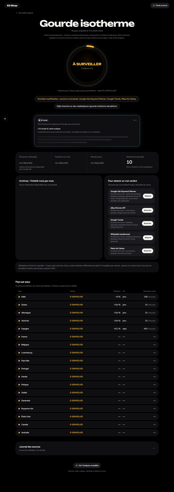
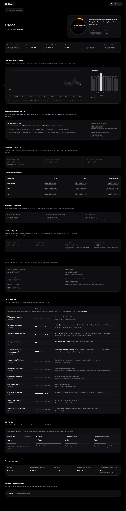
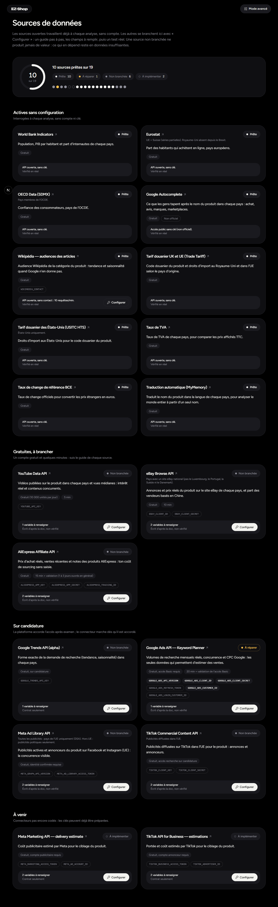
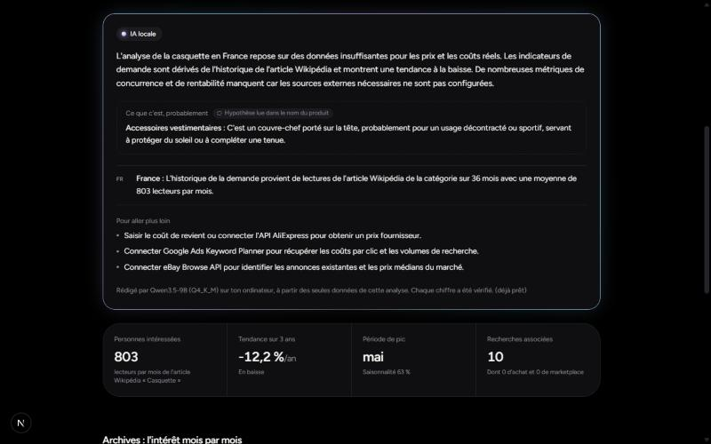
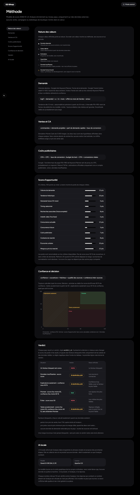

# EZ-Shop

**Recherche produit avant lancement, pour l'e-commerce et le dropshipping.**

Tu tapes le nom d'un produit (ou tu colles le lien de sa fiche Temu, AliExpress, Alibaba ou 1688) et EZ-Shop
te dit, pays par pays, si le produit vaut la peine d'être envisagé : **OUI**, **NON** ou **À SURVEILLER**, avec
ses raisons.

EZ-Shop n'utilise que des données externes réelles : sources publiques ouvertes et API que tu branches avec tes
propres clés. Il ne lit jamais tes ventes, ta boutique, ton Pixel ou ton historique publicitaire. Quand une
estimation honnête est impossible, l'application affiche `DATA_INSUFFICIENT` avec la raison, plutôt qu'un chiffre
inventé.


## Ce que fait EZ-Shop

- **Un verdict par pays** (OUI / NON / À SURVEILLER), une ligne de raison et les facteurs bloquants. Le disque du
  verdict est entouré d'un anneau qui se remplit jusqu'à la confiance réelle.
- **Analyse au niveau pays uniquement** : France ou « Monde entier » (18 pays : Europe, Royaume-Uni, États-Unis,
  Canada, Australie). Jamais de région, de ville ni de code postal.
- **Chaque valeur dit ce qu'elle est** : donnée observée, hypothèse, calcul dérivé ou estimation, avec ses sources et
  sa période. Le score d'opportunité (sur 100) et la confiance sont toujours séparés.
- **Liens fournisseurs reconnus hors ligne** : la plateforme et l'identifiant de l'article sont lus dans l'adresse.
  Aucune page fournisseur n'est téléchargée.
- **« Ta marge »** à partir de tes prix (prix fournisseur, livraison, prix de vente envisagé, marge visée), droits de
  douane compris quand ils sont calculables.
- **« Pour obtenir un vrai verdict »** : les sources à brancher, classées par le poids du score qu'elles couvriraient.
- **Journal des sources** : ce que chaque source a donné, a raté ou n'a pas pu donner, pour chaque analyse.
- **Mode simple** (le verdict et l'essentiel) et **mode avancé** (score détaillé, critères, hypothèses, provenance).
- **Une IA locale** qui reformule l'analyse en français simple (voir plus bas).

<table>
  <tr>
    <td></td>
    <td></td>
  </tr>
  <tr>
    <td></td>
    <td></td>
  </tr>
</table>

## L'IA locale

EZ-Shop intègre un modèle de langage ouvert, **Qwen3.5-9B** (licence Apache-2.0, quantification Q4_K_M), qui tourne
**entièrement sur la carte graphique de ton ordinateur** grâce à
[node-llama-cpp](https://github.com/withcatai/node-llama-cpp). L'intégration dans l'application (fiche de faits,
garde-fou des nombres, cache, interface) a été écrite par l'auteur du projet.

Ce qu'elle fait :

- elle **reformule** l'analyse déjà enregistrée en quelques phrases claires, pays par pays ;
- elle **propose des prochaines étapes** (quelle source brancher, quel prix saisir) ;
- elle décrit en une phrase ce qu'est probablement le produit, présenté comme une hypothèse.

Ce qu'elle ne fait pas :

- elle **ne produit aucune donnée** et ne collecte rien : elle lit seulement ce que l'analyse contient ;
- **chaque nombre qu'elle écrit est vérifié** contre l'analyse. Une réponse qui contient un nombre absent de
  l'analyse est refusée et n'est pas affichée ;
- **aucun cloud, aucune clé d'API** : ni le produit, ni l'analyse, ni la réponse ne quittent ta machine.

Le texte écrit par l'IA est toujours placé dans une **mini aura** (un cadre au halo monochrome) avec le badge
« IA locale », pour qu'il ne soit jamais confondu avec les données.



Limites connues : le garde-fou ne lit que les chiffres (une quantité écrite en toutes lettres passe sans contrôle),
il vérifie qu'un nombre existe dans l'analyse mais pas qu'il est attribué au bon pays, et l'IA peut se tromper sur le
sens d'une donnée. La lecture sert à comprendre plus vite, pas à décider à ta place. L'IA est facultative : sans
le modèle, ou avec `LOCAL_AI_ENABLED=false`, l'analyse fonctionne normalement.

## Stack technique

- Next.js 16 (App Router, Turbopack), React 19, TypeScript strict
- Tailwind CSS 4, composants shadcn/ui (Radix), Recharts
- Zod pour la validation, Drizzle ORM
- Base de données embarquée PGlite (Postgres en WASM), ou Postgres / Supabase via `DATABASE_URL`
- node-llama-cpp 3.22.2 pour l'IA locale (binaires précompilés Vulkan, CUDA, Metal ou CPU)
- Vitest pour les tests, ESLint

## Démarrage rapide

Prérequis : Node.js 22.12 ou plus récent et npm. Le détail est dans [docs/INSTALL.md](docs/INSTALL.md).

```bash
git clone https://github.com/Milis0f/EZ-Shop.git
cd EZ-Shop
npm install
cp .env.example .env.local
npm run dev
```

Ouvre http://localhost:3000. Aucun serveur de base de données, aucun Docker et aucune clé ne sont nécessaires pour
une première analyse : la base PGlite est créée dans `.data/pglite` au premier lancement, et les sources ouvertes
(Banque mondiale, Eurostat, OCDE, Wikipédia, Google Autocomplete, tarifs douaniers, TVA, taux de change BCE,
traduction) répondent sans compte. Pour l'IA locale, télécharge le modèle (environ 5,7 Go) comme indiqué dans
[docs/INSTALL.md](docs/INSTALL.md#4-télécharger-le-modèle-de-lia-locale).

## Documentation

- [Installation](docs/INSTALL.md) : prérequis, variables d'environnement, base de données, modèle d'IA, tests,
  dépannage.
- [Tutoriel](docs/TUTORIAL.md) : ta première analyse pas à pas, lire le verdict, brancher des sources, FAQ.
- [Architecture](docs/ARCHITECTURE.md) : dossiers, flux de données, provenance, score, pipeline de l'IA locale.
- La page **Méthode** de l'application détaille les formules, les poids du score et la règle du verdict.



## État du projet et limites

EZ-Shop est un outil local en version 0.1 (V1 « données réelles uniquement »). Il est pensé pour tourner sur ta
machine, pas pour être exposé sur Internet : il n'y a pas d'authentification, et la protection des routes d'API se
limite à une vérification d'origine et à une limite de débit.

Ce qu'il faut savoir avant de l'utiliser :

- **Sans source à clé, la plupart des verdicts restent « À SURVEILLER »**, avec une confiance faible. C'est voulu :
  les volumes de recherche, les coûts par clic et la concurrence publicitaire viennent de Google Ads Keyword
  Planner, Google Trends, Meta Ad Library ou TikTok, qui demandent un compte ou une candidature.
- Les connecteurs Google Ads, Meta Ad Library, TikTok Commercial Content, YouTube, eBay et AliExpress sont écrits
  d'après la documentation officielle mais **n'ont pas encore été vérifiés avec de vraies clés**. Google Trends
  (API alpha), Meta Marketing et TikTok Business ne sont pas encore codés.
- Les statistiques dérivées d'eBay (prix médian) et de YouTube (vues médianes) sont désactivées tant que leurs
  licences n'ont pas été vérifiées : seules les annonces et vidéos observées sont montrées.
- Les audiences Wikipédia et les suggestions Google sont des **signaux indirects**, jamais des volumes de recherche.
- Le chiffre d'affaires est calculé dans une seule devise (EUR).
- Les analyses tournent dans la requête (une analyse « Monde entier » prend environ 15 secondes), sans file de
  tâches en arrière-plan.
- Les lectures de l'IA sont gardées en mémoire : un redémarrage du serveur les régénère.

## Licence

Licence : à définir par l'auteur. Tant qu'aucun fichier de licence n'est publié, le code n'est pas proposé sous une
licence ouverte.

Le modèle Qwen3.5-9B n'est pas inclus dans ce dépôt : il se télécharge à part et reste soumis à sa propre licence
(Apache-2.0).
