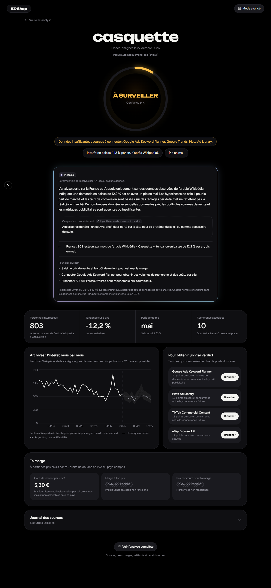
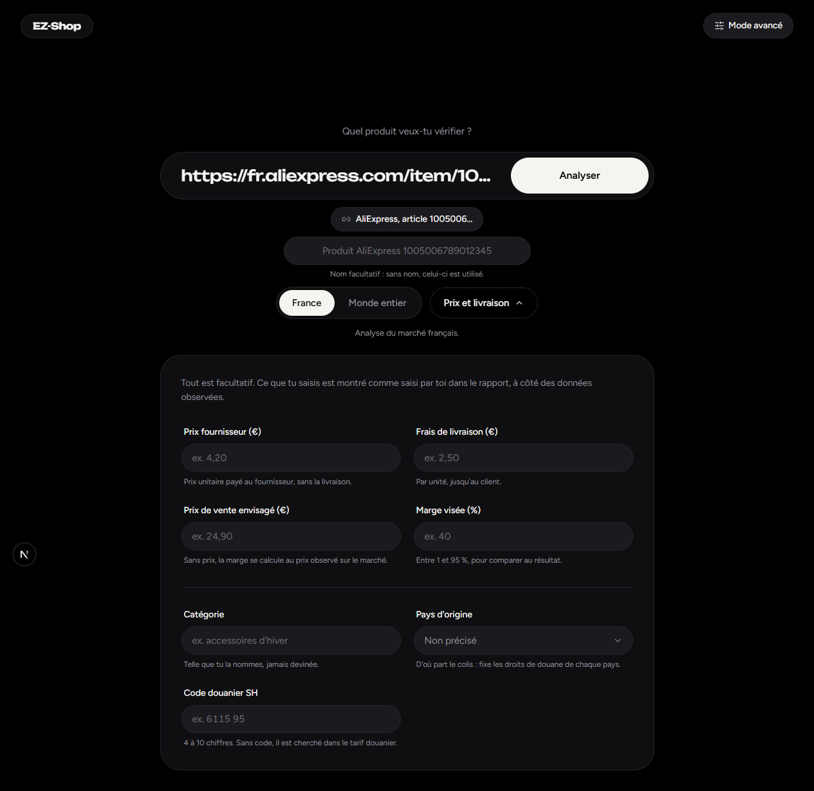

# EZ-Shop

**Pre-launch product research for e-commerce and dropshipping, country by country, with real data only and a local AI.**

Give EZ-Shop a product name or a supplier link (Temu, AliExpress, Alibaba, 1688). For each target country it tells you
**YES, NO or WATCH**, with the reason, the blocking factors and a confidence score, before you spend anything on stock
or ads. The interface is available in **English, French and Spanish**.



## Quick start

Requirements: **Node.js 22.12+** and npm. Windows, macOS or Linux.

```bash
git clone https://github.com/Milis0f/EZ-Shop.git
cd EZ-Shop
npm install
cp .env.example .env.local
npm run dev
```

Open http://localhost:3000. No database server, no Docker and no API key are needed for a first analysis: a local
PGlite database is created in `.data/pglite`, and the open sources (World Bank, Eurostat, OECD, Wikipedia, Google
Autocomplete, customs tariffs, VAT, ECB exchange rates) answer without an account.

### Optional: enable the local AI

Download the model (about 5.7 GB) into `.data/models/`:

```bash
pip install -U huggingface_hub
hf download unsloth/Qwen3.5-9B-GGUF Qwen3.5-9B-Q4_K_M.gguf --local-dir .data/models
```

SHA-256: `03b74727a860a56338e042c4420bb3f04b2fec5734175f4cb9fa853daf52b7e8`. A GPU with about 8 GB of VRAM is
recommended (Vulkan, CUDA or Metal through prebuilt binaries; CPU works, slowly). Set `LOCAL_AI_MODEL_PATH` to use
another location, or `LOCAL_AI_ENABLED=false` to turn the AI off. Without the model, everything else works.

### Other commands

```bash
npm run build && npm start   # production
npm test                     # unit tests
npm run typecheck && npm run lint
```

## What it does

- **A verdict per country**: YES, NO or WATCH, with one line of reason and the blocking factors (e.g. a loss at
  your selling price). Missing data gives « WATCH, insufficient data », never an optimistic guess.
- **Real data only**: every value carries its source and its kind (observed, assumption, derived, estimate). When a
  value is missing or unreliable, the app shows `DATA_INSUFFICIENT` with the reason. No number is ever invented.
- **Your own numbers**: supplier price, shipping, planned selling price and target margin give your landed cost
  (duties included), your margin at your price and the minimum price for your target margin.
- **Supplier links recognised offline**: the app reads the platform and product id from the URL and never scrapes
  supplier pages.
- **Simple and expert modes**: the simple mode leads with the verdict; the expert mode shows the score out of 100,
  its criteria, confidence, sources, limits and a per-provider source journal.
- **Country level only**, 18 countries supported.
- **Three languages**: English (default), French and Spanish, chosen from the switcher in the navigation bar.
  Numbers, prices and dates follow the chosen language.
- **OLED design**: true black, dark only, very round, with motion that answers your actions and respects reduced
  motion settings.

## The local AI

EZ-Shop runs an AI model **entirely on your own computer**: Qwen3.5-9B (open model, Apache-2.0), loaded on your GPU
through [node-llama-cpp](https://github.com/withcatai/node-llama-cpp), inside the app. No cloud, no API key, no data
leaves your machine.

On each analysis it writes, in the interface language, a short summary, one line per country, up to three concrete next steps, and a
hypothesis about what the product is. It only rewords the stored analysis: **every number it cites is checked
against the analysis data**, and a reading that cites a number not found there is discarded and never shown. It never
produces data. Everything the AI wrote is marked by a small animated « aura », so you always know what comes from the
AI and what comes from the data.



## Connecting more sources

Search volumes, CPC and ad competition come from sources that need an account (Google Ads Keyword Planner, Meta Ad
Library, TikTok, YouTube, eBay, AliExpress). Add their keys to `.env.local` (see `.env.example`) or from the
**Data sources** page of the app. Without them, most verdicts stay « WATCH » with low confidence, by design.

## Stack

Next.js 16, React 19, TypeScript (strict), Tailwind CSS 4, shadcn/ui, Zod, Drizzle ORM with PGlite (or PostgreSQL
via `DATABASE_URL`), node-llama-cpp, Vitest.

## Status and limits

Version 0.1, meant to run locally (no authentication: do not expose it on the internet). Some keyed connectors are
written from the official docs but not yet tested with real keys. Derived eBay and YouTube statistics are disabled
until their licence terms are checked. Wikipedia readers and Google suggestions are indirect signals, never search
volumes.

Detailed guides (in French): [installation](docs/INSTALL.md), [tutorial](docs/TUTORIAL.md),
[architecture](docs/ARCHITECTURE.md).

## Licence

[GNU AGPL-3.0](LICENSE). The Qwen3.5-9B model is not included and stays under its own licence (Apache-2.0).
